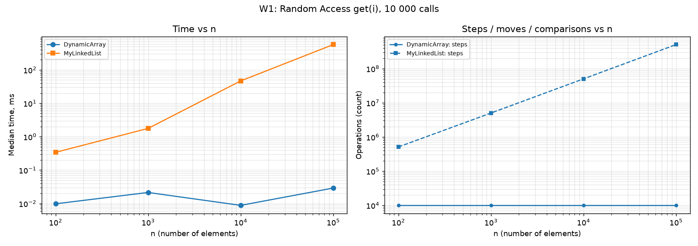
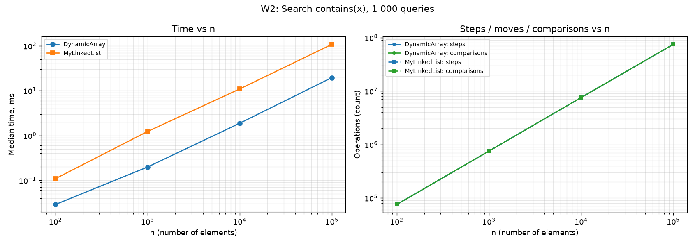
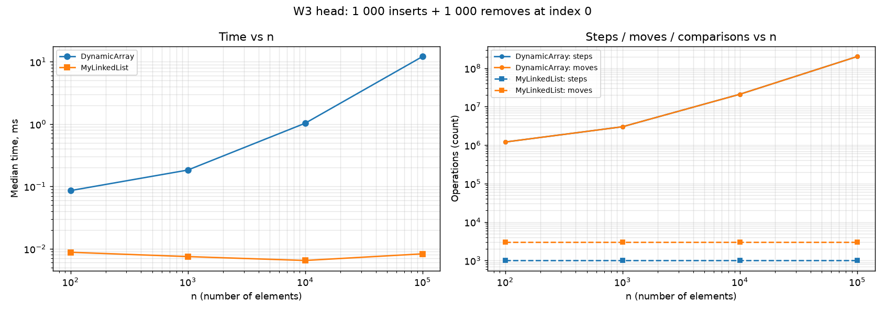
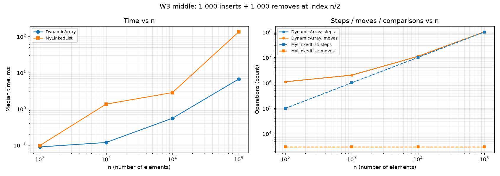
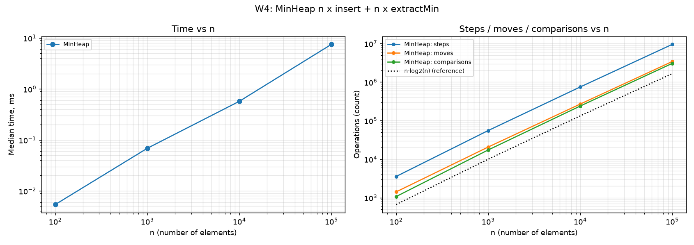
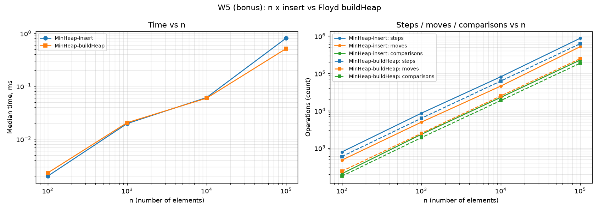
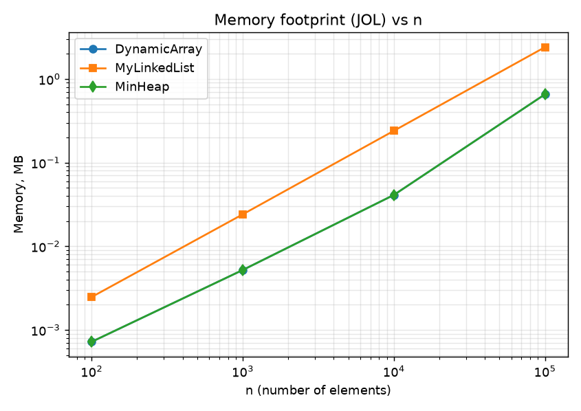

# DAA Assignment 2 — In-Memory Workload Engine

**Author:** <Moldir Amanbek SE-2521>  
**Environment:** <MacBook Pro, M4, 16 GB> (fill in), seed 42, 3 warm-up + 5 measured runs, median time.  
**Repository:** <GitHub link>, branch `main`, tag `v1.0`.

All structures store primitive `int` (no generics, no `Integer`) and do not use `java.util` collections.

## 1. Counting rules

| Counter | Definition |
|---|---|
| steps | one read of an array cell, or one move to the next node |
| moves | one element shifted or written in an array, or one pointer update in the list (node creation is not a move) |
| comparisons | one comparison of two elements |

Counters are incremented inside the methods. Example: `MyLinkedList.get(i)` = `i` moves to the next node + 1 read = `i + 1` steps; `DynamicArray.get(i)` = 1 step.

## 2. Complexity table

Notation: n = current size, h = ⌊log₂ n⌋ = heap height. Θ is used when the bound is tight for that case.

### DynamicArray (capacity grows 2x)

| Operation | Best | Average | Worst | Justification |
|---|---|---|---|---|
| get(i) | Θ(1) | Θ(1) | Θ(1) | direct index access |
| add(x) | Θ(1) | Θ(1) amortized | Θ(n) | one write; a full array is copied once (n moves), but doubling makes the sum over n adds ≤ 3n |
| add(i, x) | Θ(1) (i = size) | Θ(n) | Θ(n) (i = 0) | shifts size − i elements; average i is uniform → n/2 shifts |
| remove(i) | Θ(1) (i = size−1) | Θ(n) | Θ(n) (i = 0) | shifts size − i − 1 elements |
| contains(x) | Θ(1) (x at index 0) | Θ(n) | Θ(n) (x absent) | linear scan: n/2 reads if present at random place, n if absent |
| space | Θ(n) | Θ(n) | Θ(n) | array of capacity between n and 2n; resize needs a temporary Θ(n) array |

### MyLinkedList (singly linked, head + tail)

| Operation | Best | Average | Worst | Justification |
|---|---|---|---|---|
| get(i) | Θ(1) (i = 0) | Θ(n) | Θ(n) (i = n−1) | must walk i nodes from head |
| add(x) | Θ(1) | Θ(1) | Θ(1) | tail pointer, 2 pointer updates |
| add(i, x) | Θ(1) (i = 0 or size) | Θ(n) | Θ(n) | walk to node i−1, then 2 pointer updates |
| remove(i) | Θ(1) (i = 0) | Θ(n) | Θ(n) (i = n−1) | singly linked: need the predecessor, so walk i−1 nodes |
| contains(x) | Θ(1) (x at head) | Θ(n) | Θ(n) (x absent) | linear scan |
| space | Θ(n) | Θ(n) | Θ(n) | one node object per element (header + int + reference) |

### MinHeap (array-based binary heap)

| Operation | Best | Average | Worst | Justification |
|---|---|---|---|---|
| insert(x) | Θ(1) (x ≥ parent) | Θ(1) expected on random data | Θ(log n) (x is new minimum) | bubble-up ≤ h levels; measured 2.28 comparisons per insert (W5, n = 100 000) |
| peekMin() | Θ(1) | Θ(1) | Θ(1) | reads `a[0]` |
| extractMin() | Θ(1) (all keys equal, no swap) | Θ(log n) | Θ(log n) | the moved last element is usually large and sinks ~h levels, 2 comparisons per level |
| buildHeap(arr) (bonus) | Θ(n) | Θ(n) | Θ(n) | Floyd: Σ over levels (n/2^(k+1))·k = O(n); ≥ n/2 internal nodes are always checked |
| space | Θ(n) | Θ(n) | Θ(n) | array, capacity between n and 2n |

## 3. Loop invariant proofs

### Proof 1 — `DynamicArray.contains(x)`

```java
for (int i = 0; i < size; i++) {
    if (data[i] == x) return true;
}
return false;
```

- **Invariant:** before every check of the loop condition, `0 ≤ i ≤ size` and `x` does not occur in `data[0..i-1]`.
- **Initialization:** for `i = 0` the range `data[0..-1]` is empty, so `x` is not in it. `0 ≤ 0 ≤ size`.
- **Maintenance:** assume the invariant holds before an iteration with index `i < size`. If `data[i] == x`, the method returns `true` and the loop ends (the answer is correct). Otherwise `data[i] != x`, so `x` is not in `data[0..i]`; after `i++` the invariant holds for the new `i`, and `i ≤ size` still holds.
- **Termination:** the loop ends either by `return true`, or when `i == size`. In the second case the invariant says `x` does not occur in `data[0..size-1]`, i.e. in the whole structure.
- **Conclusion:** if `x` is stored, the first matching index is found and `true` is returned; if the loop finishes normally, the invariant proves `x` is absent, so `false` is correct. The loop always stops because `i` grows by 1 up to `size`.

### Proof 2 — shift loop in `DynamicArray.remove(index)`

```java
int removed = data[index];
for (int i = index; i < size - 1; i++) {
    data[i] = data[i + 1];
}
size--;
```

Let `old` be the contents of the array before the loop.

- **Invariant:** before every check of the loop condition, `index ≤ i ≤ size-1`, `data[0..index-1] = old[0..index-1]`, `data[index..i-1] = old[index+1..i]`, and `data[i..size-1] = old[i..size-1]` (not yet changed).
- **Initialization:** for `i = index` the middle part `data[index..index-1]` is empty, the left part was never touched, and the right part `data[index..size-1]` is still `old`.
- **Maintenance:** in the iteration we execute `data[i] = data[i+1]`. Position `i+1 > i` is in the untouched part, so `data[i+1] = old[i+1]`. Therefore `data[index..i] = old[index+1..i+1]`; the right part now starts at `i+1` and is unchanged. After `i++` the invariant holds. Position `i+1` is read before it is ever written, so no value is lost.
- **Termination:** the loop stops when `i = size-1`. The invariant gives `data[index..size-2] = old[index+1..size-1]` and `data[0..index-1] = old[0..index-1]`.
- **Conclusion:** after `size--` the first `size` cells are exactly `old` without the element at `index`, in the same order, and `removed = old[index]` was saved before the loop. Hence `remove` is correct.

## 4. Benchmark results

Full data: `results/results.csv`. Each chart: left = median time vs n, right = steps / moves / comparisons vs n (log-log axes; only non-zero counters are drawn; in W3 head/middle the array's `steps` and `moves` lines coincide).








Key numbers (n = 100 000; replace with the values from your own run):

| Workload | DynamicArray               | MyLinkedList                             |
|---|----------------------------|------------------------------------------|
| W1 get(i) ×10 000 | 0.029 ms, 10 000 steps     | 570.7 ms, 505 028 648 steps              |
| W2 contains ×1 000 | 31.6 ms, 74 565 647 steps  | 107.6 ms, 74 565 647 steps               |
| W3 head (1 000 ins + 1 000 rem) | 12.1 ms, 201 000 000 moves | 0.0083 ms, 3 000 moves + 1 000 steps     |
| W3 middle | 6.6 ms, 101 000 000 moves  | 133.2 ms, 99 999 000 steps + 3 000 moves |

W4 (MinHeap, n = 100 000): 7.5ms, 3 059 283 comparisons (n·log₂n ≈ 1.66·10⁶; extractMin uses 2 comparisons per level, so ≈ 2·n·log₂n is the upper bound, 3.3·10⁶).

## 5. Discussion

1. In W1 the array needs exactly 10 000 steps for 10 000 `get` calls at every n, while the list needs 505 million steps at n = 100 000, which matches the Θ(1) vs Θ(n) bounds.
2. Time agrees in direction: 0.029 ms for the array against about 570.7 ms for the list (about 20 000x); this is smaller than the 50 000x step ratio because one list step is very cheap (about 1 ns here) while an array get costs about 3 ns including the call and counter updates
3. Even for plain iteration the array wins, because its `int`s lie next to each other: one 64-byte cache line holds 16 values, so the CPU prefetcher loads the next elements before they are requested (spatial locality).
4. W2 is the cleanest proof that equal Big-O does not mean equal time: both structures perform exactly 74 565 647 steps and comparisons at n = 100 000, but the list takes 107.6 ms and the array only 19.5 ms (about 5.5x).
5. The reason is pointer chasing: to read `curr.next` the CPU must first finish loading `curr`, so the loads form a dependent chain that cannot overlap, and in a long-running program nodes allocated at different times are scattered over the heap and cause cache misses (in this benchmark all nodes are allocated in one loop and lie fairly close together, which is why the gap is "only" about 5x and not larger).
6. Each node also carries an object header (about 12 bytes) and a reference next to a 4-byte `int` (24 bytes per node with compressed pointers), so only a small fraction of every cache line is useful data, and about 6x more memory is read per element than in the array.
7. Many small node objects also give the garbage collector more work than one large `int[]`, which is another reason why the list is slower at equal step counts.
8. The list wins when changes happen at the head: in W3 head, the list does 1 000 steps and 3 000 pointer updates independent of n, while the array shifts 201 000 000 elements at n = 100 000 (12.1 ms against 0.0083 ms).
9. In W3 middle the situation is reversed in time even though step counts are nearly equal (99 999 000 for the list vs 101 000 000 moves for the array): the array shift is a sequential loop over contiguous memory, while the list must first walk to the middle through pointers (133.2 ms vs 6.6 ms), so O(1) insertion in a list only helps when you already hold the node or work at the head.
10. MinHeap is the right choice for priority scheduling: `peekMin` is O(1) and `extractMin` is O(log n) (W4: 3.06·10⁶ comparisons for 100 000 inserts + extracts), while a sorted array would need O(n) per insert and an unsorted one O(n) per extract.
11. A heap stores its tree in one `int[]`, so it keeps the cache-friendly layout of the array; it only gives the minimum quickly, not fast search or arbitrary indexing.
12. A linked list is preferable for queues/stacks, undo history and similar workloads with many head insertions or removals and no random access; a `DynamicArray` is preferable in all other cases (indexing, iteration, search, appending at the end).
13. Bonus B: Floyd's `buildHeap` needs fewer comparisons than n inserts on the same data (187 911 vs 227 857 at n = 100 000, about 17% fewer, and about half of the moves: 248 330 vs 519 586) and is Θ(n) in the worst case, while n inserts are Θ(n log n) in the worst case (for example, descending input).
14. In time, buildHeap was also faster in this run: 0.51 ms against 0.81 ms for n inserts (about 1.6x), which matches its smaller counters (187,911 vs 227,857 comparisons and about half as many moves). The gap is only a constant factor on random data, because an insert costs Θ(1) on average (2.28 comparisons); the asymptotic advantage Θ(n) against Θ(n log n) is guaranteed for the worst case, for example descending input.
## 6. Bonus A — memory footprint (JOL)

Run `mvn -q compile exec:java -Dexec.mainClass=MemoryFootprint`, then `python plot.py`, and paste your numbers here.

n	DynamicArray, bytes	MyLinkedList, bytes	MinHeap, bytes
100	720	2 472	720
1 000	5 200	24 072	5 200
10 000	41 040	240 072	41 040
100 000	655 440	2 400 072	655 440


MyLinkedList$Node object internals:
OFF  SZ                TYPE DESCRIPTION               VALUE
0   8                     (object header: mark)     N/A
8   4                     (object header: class)    N/A
12   4                 int Node.val                  N/A
16   4   MyLinkedList.Node Node.next                 N/A
20   4                     (object alignment gap)    
Instance size: 24 bytes
Space losses: 0 bytes internal + 4 bytes external = 4 bytes total
At n = 100,000 the linked list takes 2.4 MB versus 0.66 MB for the array (about 3.7x more), and at n = 10,000 the gap is almost 5.9x (240 KB versus 41 KB). Each node weighs 24 bytes: a 12-byte object header, a 4-byte int, a 4-byte next reference, and 4 bytes of padding to align the object size to a multiple of 8. Only 4 of these 24 bytes are useful data. For the array, the cost per element ranges from about 4 to about 7 bytes, depending on how full the last doubled buffer is (655,440 bytes at n = 100,000 because the capacity is 163,840). MinHeap uses the same amount of memory as DynamicArray, because it stores its data in the same kind of int[] that doubles when full.


Note: the DynamicArray line is hidden under the MinHeap line because both structures use an int[] with the same doubling policy and therefore occupy exactly the same memory.

Explanation to write: a node = 12-byte object header + 4-byte `int` + 4-byte reference (compressed oops) = 20 bytes, rounded up by alignment to 24 bytes (JOL prints this layout). The array needs only 4 bytes per element plus one 16-byte array header, but up to 2x capacity after doubling, so between 4 and 8 bytes per element.
